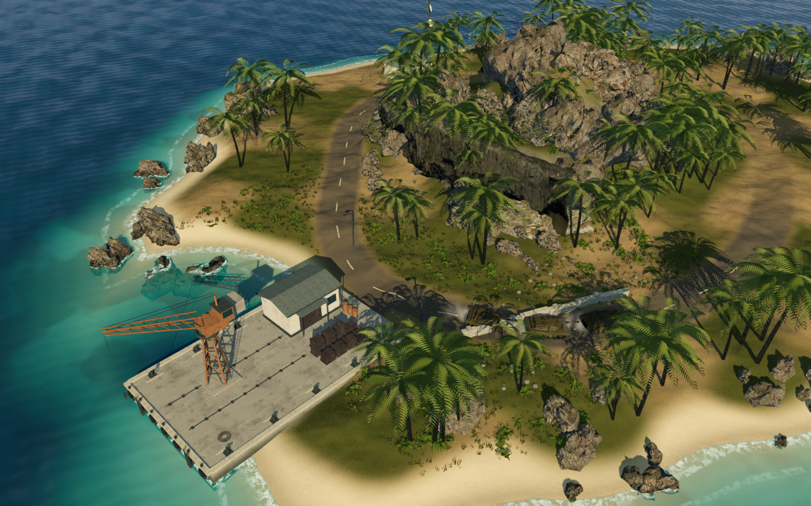
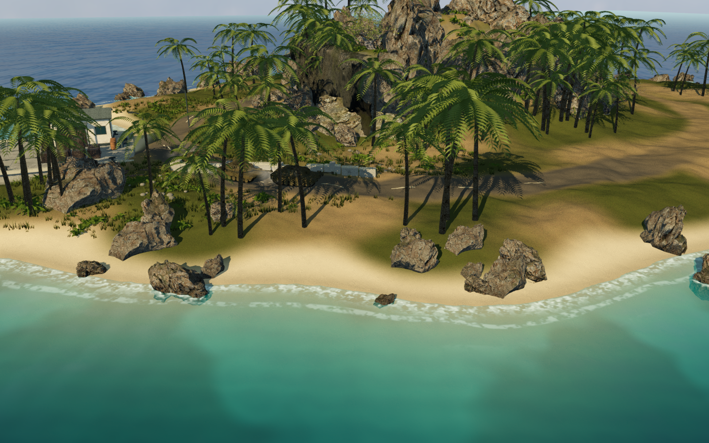

# Harbour art study

`ArtStudy.tscn` is a standalone, animated 3D scene for reviewing Breakwater's proposed visual direction. It explores the warm tropical island in [the concept](research/tropical-battlefield-concept.png), with a new shoreline, continuous terrain, a coast road, rock outcrops, palms, a small harbour and radio station. The screenshots below come directly from Godot. The concept image is not a backdrop.

The latest pass replaces the oversized smooth boulders with overlapping scanned rock formations and a broken rocky coastline. Shallow water now reveals submerged rock and sand, with foam following actual water depth around rocks and the quay. The harbour retains its lattice crane, corrugated-roof store, cargo, moorings, weathering and dense ground cover. The scene opens on that section by default.

The scene remains a separate demonstration route without combat or objectives. Its approved materials, scenery, palms, ground cover, harbour and vehicle finish now also appear in the playable campaign: **F5 runs the updated main game**. See [main-game integration](MAIN_GAME_VISUALS.md) for gameplay captures and checks. The [research notes](FUN_AND_VISUAL_RESEARCH.md) cover combat improvements separately.

## Open the scene

Open the project in **Godot 4.7.2 .NET**, allow the assets to import, build C#, open `ArtStudy.tscn`, and press **F6** (Run Current Scene).

Or run from the repository in PowerShell:

```powershell
./Tools/PreviewArt.ps1
# Specify the .NET executable if it is not on PATH or in the local Downloads location:
./Tools/PreviewArt.ps1 -Godot 'C:/path/to/Godot_console.exe'
```

| Control | Action |
| --- | --- |
| Left drag | Orbit the current point of interest |
| Mouse wheel | Zoom |
| 1 / 2 / 3 | Overview / harbour / convoy road |
| 4 / 5 | Detailed section (default) / quay close-up |
| 6 | Coastal close-up: wet rock and shallow water |
| Space | Pause vehicle animation and the automatic orbit; waves keep moving |
| H | Show or hide captions |
| Escape | Close the study |

An automatic capture hides the captions, records frame intervals after 90 warmup frames, writes the image, and exits:

```powershell
./Tools/PreviewArt.ps1 -View detail -Screenshot './.godot/qa/detail.png' -Frames 690
./Tools/PreviewArt.ps1 -View quay -Screenshot './.godot/qa/quay.png' -Frames 690
./Tools/PreviewArt.ps1 -View coast -Screenshot './.godot/qa/coast.png' -Frames 690
./Tools/PreviewArt.ps1 -View harbour -Screenshot './.godot/qa/harbour.png' -Frames 690
./Tools/PreviewArt.ps1 -View detail -Orbit -Screenshot './.godot/qa/orbit.png' -Frames 690
```

## What the study contains

- One continuous heightfield with a curved road, a sheltered inlet and uneven beach. A shared landscape field keeps the terrain, road surface and shallow-water colors aligned.
- Scanned rock meshes with generated import LODs. A stepped central crest and smaller surrounding outcrops replace the previous oversized stones. The harbour cliff combines a long coastal scan, shorter rock faces and complete boulders, with filled terrain behind the exposed faces. Their photographed color, normal and roughness maps preserve fine rock detail; moss and wet darkening connect them to land and water.
- 213 rock fragments in 37 spatial batches, including partly submerged coastal groups and tidal rubble. Batches remain small enough to cull by region. The coast road and harbour approach are left clear.
- Three shared palm meshes with curved trunks and individual leaflets, plus imported broadleaf growth. Foliage placement leaves space around the road and station.
- 2,221 grass tufts and 371 ferns in 100 spatial batches around the harbour and hillside pockets. Placement leaves the coast road and quay clear. Shared materials, distance culling and imported LODs limit the rendering cost. Terrain shading keeps soil and vegetation on flatter hillside pockets, exposing stone on steep slopes.
- Depth-colored, translucent shallows, submerged rocks, moving wave normals and broken surf. Foam responds to opaque scene geometry, including the quay; a foreground-depth guard prevents false foam around leaves and cables. A half-precision landscape field removes the visible distance bands from the first shoreline effect.
- A slab quay with expansion joints, coping, wet staining, timber fenders, hung tyres, bollards, dock ladders, crane rails and drainage gratings. A lattice crane has a cab, counterweight, cables, hook and access ladder. The store has a pitched corrugated roof, guttering, shutters and canopy; pallets, crates, drums and coiled rope dress the working area.
- Quay stain decals, small roadside debris, capped retaining walls and lamp posts. Static harbour parts are combined by material instead of creating a separate draw call for each beam or slab. The original radio station remains elsewhere on the island.
- Existing credited vehicle models, independent hulls/turrets, a moving convoy and dust trails.
- Warm directional sunlight, cool ambient fill, sky reflections, shadows and ACES tone mapping. Lighting is dynamic; no baked-lighting pass has been added.

The art is under `assets/art-study`; source links and licenses are in [the asset credits](../assets/CREDITS.md). `Tools/FetchArtStudyAssets.ps1` can reproduce the downloads and verifies the publisher's checksums. Use `-DetailOnly` to fetch just the four additional 2K assets. All new environment imports are CC0; existing vehicle models retain their CC BY credits.

## Remaining work toward the concept

The rock silhouettes, coastline and water now read more naturally, but this is not yet a match for the concept. Repeated scan shapes and joins between cliff scans and terrain still need more careful sculpting; road wear, vegetation distribution and building materials need a consistent production art pass. Surf is an animated shading effect rather than simulated breaking waves. Dense ground cover and detailed props remain concentrated around the harbour. Stronger terrain composition and lighting polish are still needed before treating this as a finished production environment.

The campaign integration fits the shared art to existing mission geometry. Playable ground remains level, scanned ridges fit their blocking footprints and heights, Classic foliage follows the terrain grid, and the harbour stands outside the navigable boundary. The study's demonstration heightfield and roads are not the mission map. Navigable hills would require matching changes to movement, cover and line of sight.

Imported vegetation and shadow draw calls still benefit from a production pass: author foliage LODs that retain leaf coverage and test on more than one graphics card. Screen-space ambient occlusion remains disabled because it produced black rectangular artifacts on the local RX 570 during this study. The campaign now shares the study's daylight treatment; smaller group-camera views use reduced mesh detail and skip the covered main camera's world render.

## Validation

Verified on 30 September 2026 with Godot 4.7.2 .NET, Vulkan Forward+, and a Radeon RX 570. Captures requested a 1600 × 1000 window; Godot reported an actual render texture of **1777 × 1111** with this host's window scaling. Each run discarded 90 warmup frames and measured the following 600 process intervals with VSync enabled.

| Camera | Median interval | 95th percentile | Draw calls at capture | Primitives at capture |
| --- | ---: | ---: | ---: | ---: |
| Detailed section | 21.21 ms | 21.43 ms | 1,179 | 5,062,326 |
| Island overview | 18.87 ms | 19.05 ms | 796 | 2,960,973 |
| Coastal close-up | 19.44 ms | 19.70 ms | 1,271 | 6,628,048 |
| Quay close-up | 20.67 ms | 20.83 ms | 1,255 | 6,515,581 |

These are short local samples, including scheduling and VSync, **not isolated GPU timings or a guarantee of steady 60 FPS**. Median intervals correspond to roughly **47–53 FPS**, with 95th-percentile intervals around 47–52 FPS. Each capture completed with no runtime errors and the convoy moving. The coast camera also checks the water and rock intersections from a lower angle.

The previous harbour pass measured 16.96 ms median and 7,630,896 primitives in the same detailed-section camera. This pass reduces the primitive count but raises the median interval to 21.21 ms. The richer rendering has a measurable performance cost; GPU profiling and a water/shadow quality pass are needed to recover a steady 60 FPS on this card. A palm batching experiment increased draw calls and was removed. These comparisons are local samples, not a controlled cross-hardware benchmark.

After the final scene changes, `Tools/Check.ps1` passed the build with zero warnings, all **86 simulation tests**, and all six engine checks: smoke, UI, campaign, Classic, settings and settings reload. Both PowerShell tools passed syntax validation. All **46 downloaded source files across eight assets** match the preserved publisher checksums. Godot's headless editor import has emitted an editor `HotReloadAssemblyWatcher` timer message during shutdown on this installation; the scene captures and six game checks do not emit that error. `Docs/.gdignore` keeps these reference images and screenshots out of the game asset imports.

## Current engine captures





[Current island overview](art-study/coast/overview.png) · [Current quay view](art-study/coast/quay.png)

The previous study captures are preserved for comparison: [detailed section before the rock-and-surf pass](art-study/detail/detail.png), [previous quay](art-study/detail/quay.png), [first harbour study](art-study/harbour.png), [original overview](art-study/overview.png), [original convoy view](art-study/road.png), and [original orbit](art-study/orbit.png).

The water's depth reconstruction follows Godot's [depth-texture documentation](https://docs.godotengine.org/en/stable/tutorials/shaders/advanced_postprocessing.html#depth-texture); transparent-pass behavior is described in [screen-reading shaders](https://docs.godotengine.org/en/stable/tutorials/shaders/screen-reading_shaders.html).
