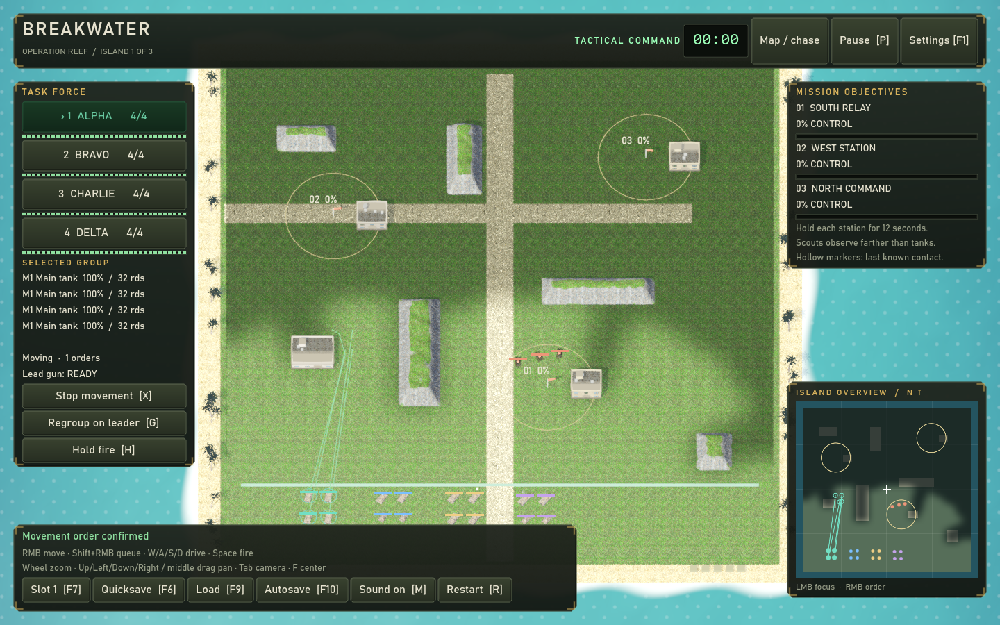
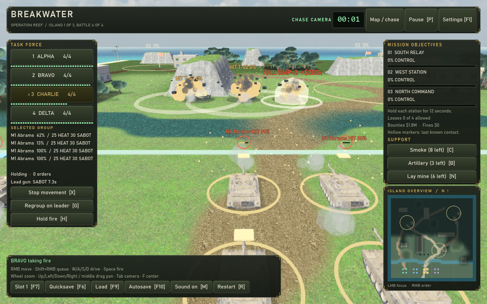
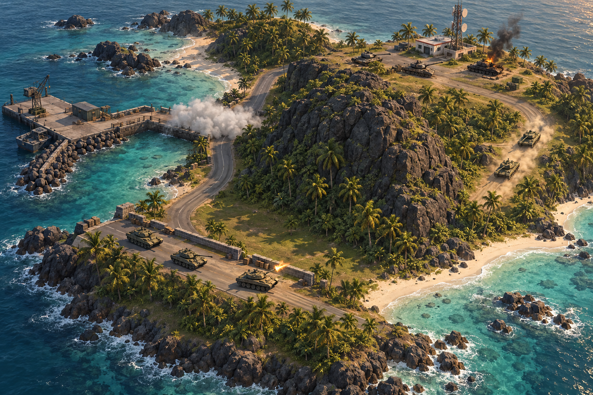

# Breakwater: making combat worth commanding

Research and design recommendations · 29 September 2026

**Recommendation:** build the next iteration around short, readable battles in which reconnaissance, coordinated movement and timely withdrawal visibly change the outcome. Preserve the four-group command fantasy and optional gunner view. Make competent crews carry out a plan, and give the player a reason to revise it.

The player's stated concern is that combat feels passive or repetitive. The findings below prioritise that concern. This is a code and presentation review supported by game-design research, not a completed human playtest. The build succeeded and three fresh previews were rendered and inspected using the project's Forward+ renderer. Staged combat screenshots demonstrate presentation, not normal encounter balance. Proposed timings and success criteria are hypotheses to test.

## What the current game is doing

Breakwater already contains considerable useful work: pause with movement orders, reconnaissance and remembered contacts, terrain and ballistic obstruction, group movement, persistent losses, supply, smoke, artillery, different vehicles, combat effects, night fighting and several objectives. Their availability differs between modes.

| Finding from the implementation | Likely effect on play | Priority |
| --- | --- | --- |
| Classic projectile damage calls `ClassicDamage`; Modern calls `ArmorDamage`. Classic still classifies the hit's facing, but does not apply the directional damage multipliers. Modern uses 0.55 front, 0.9 side and 1.35 rear. | A flank in Classic can improve sight and firing opportunities, but does not earn the armour advantage players may expect. | Highest |
| Classic automated friendly guns use a 2.5 spread multiplier, enemy guns 1.5, and manually aimed guns 0.6. Friendly automated angular spread is about 4.17 times the manual spread under equivalent conditions. This is not a 4.17-fold hit-probability claim. | The design explicitly rewards taking over individual guns. Successful command can still feel ineffective when unattended crews miss. | Highest |
| Classic garrisons stop and fight around their posts. The enemy command system returns immediately in Classic. Scripted assault/convoy columns are exceptions. Modern already has relief, counterattacks and finite reinforcement waves. | Classic's ordinary garrison battles offer fewer reasons to change a working plan. Modern's existing reactions are a useful starting point. | High |
| Classic jungle edge multiplies shot spread by 16, versus 0.5 on roads. Hit damage also varies from 25% to 100% of nominal damage. | Large hidden modifiers can make similar-looking exchanges feel inconsistent or protracted. Holding the best edge may outweigh more interesting manoeuvres. | High |
| The command interface exposes movement, stop, regroup and fire discipline, with support actions in Classic. It lacks explicit target priority, destination facing, reverse withdrawal and a coordinated fire order. | The player can express less tactical intent than the simulation appears capable of supporting. More manual gun clicks do not solve that gap. | High |
| Modern uses three reversible station captures on each island. Classic already adds training, ambush, defence, destruction, clearance and escort missions. | Modern needs richer situations; Classic needs better encounters within its existing variety. Adding mission labels alone will not fix repetition. | Medium |

Evidence: [Classic tuning](../Scripts/Core/ClassicRules.cs), [damage routing](../Scripts/Core/Simulation.Combat.cs), [Classic AI](../Scripts/Core/Simulation.Classic.cs), [enemy command](../Scripts/Core/Simulation.Command.cs), [terrain](../Scripts/Core/TerrainMap.cs), [available commands](../Scripts/IBattleCommands.cs), [zone missions](../Scripts/Core/ClassicCampaign.cs).

These are plausible causes, not proof of which one dominates a particular player's experience. Test Classic and Modern separately; changing Classic crew accuracy cannot explain or fix Modern combat by itself.

## What the research suggests

| Reference | Relevant evidence | Application to Breakwater |
| --- | --- | --- |
| *Pacific Islands* original manual | Four independently managed platoons, map/sight/status views, vehicle matchups and stationary missile fire make coordination central to its identity. | Retain the feeling of commanding several fronts and choosing when to take a gun. Modernise how the player understands and gives orders. [1992 manual transcription](https://www.lemonamiga.com/doc/pacific-islands/1188) |
| Matthew Davis, *Into the Breach* design postmortem | Readability, short experiences, reduced wasted time and interesting choices were explicit constraints. Revealed attacks shaped both combat and interface design. | Telegraph actionable danger and show why an order will work. Keep fog of war: reveal reported intentions and observed threats, not the hidden world's exact state. [Developer's GDC slides, pp. 8–21, 28–35](https://media.gdcvault.com/gdc2019/presentations/Into%20the%20Breach%20Postmortem%20Final.pdf) |
| Relic, *Company of Heroes 3* | Tactical pause supports queued plans; side armour explicitly rewards positioning; destruction can create routes. | Extend Breakwater's existing pause into clearer coordinated orders. Reward flanks consistently and make a few pieces of destruction strategically useful. [Relic feature description](https://help.relic.com/hc/en-us/articles/36158533228563-CoH3-Launch-Content-Beyond) |
| Michael Booth, *The AI Systems of Left 4 Dead* | The pacing system alternates threat buildup, peaks and recovery; the presentation distinguishes pacing from difficulty. | Author a warning, a committed attack and a recovery opportunity. Prototype this with a small encounter script before building a general director. [Valve slides, pp. 77–92](https://steamcdn-a.akamaihd.net/apps/valve/2009/ai_systems_of_l4d_mike_booth.pdf) |
| *Bad North* | Its official pitch makes the unique shape of each island part of the tactics. | Give each island a silhouette and route structure the player can remember and exploit. [Official game overview and images](https://www.badnorth.com/) |
| Valve, *Illustrative Rendering in Team Fortress 2* | Silhouettes, value structure, restrained texture detail and lighting support fast scene recognition. | Unify materials and separate vehicles from the ground before increasing asset detail. [Valve rendering paper, sections 3–4](https://steamcdn-a.akamaihd.net/apps/valve/2007/NPAR07_IllustrativeRenderingInTeamFortress2.pdf) |

These references provide design precedents. They do not establish that borrowing any particular mechanic will make Breakwater fun. The proposals below are the synthesis to test.

## The combat loop to build

**Scout → choose an approach → coordinate a short attack → read the result → reposition.**

For example: a scout identifies two tanks covering a causeway. Alpha keeps them facing south while Bravo takes a sheltered route. The player waits until Bravo is ready, releases the attack, and sees a clear side hit. An intercepted reinforcement order then creates a choice: exploit the opening or withdraw a damaged vehicle under smoke.

The satisfaction should come from causing that sequence. Merely increasing damage or enemy count would leave the central decision unchanged.

### 1. Make manoeuvres reliably worthwhile

First test directional damage in the experimental Classic encounter and reduce the disparity between automatic and manual gunnery. Keep manual aim useful for choosing a particular shot; let a well-positioned, stationary crew reliably threaten an exposed target. Retune damage variability and extreme cover spread together so improved accuracy does not simply make everything die too quickly.

Expose the relevant reason: `CLEAR SHOT`, `BLOCKED BY RIDGE`, `MOVING`, `SIDE EXPOSED`, `RELOADING`. Keep uncertainty honest; use qualitative shot quality unless an actual probability model has been implemented. Ground and target information must respect reconnaissance.

Use a lateral route to change firing angle, concealment or time to contact. Do not make every flank longer but otherwise equivalent to the main road.

### 2. Give orders that express a plan

Start with **priority target**, **move and face**, and **reverse to cover**. These address target selection, armour orientation and saving a damaged unit. Destination previews should show the proposed formation, known line of fire and obstruction. The preview and the eventual shot must use compatible rules.

Next add a clear **hold until released** order shared by selected groups. Existing movement queuing and fire discipline provide a base, but synchronised release is new work. Show which groups are ready before release. Support pause for these orders so success depends on judgment rather than frantic switching.

Introduce two groups in the first encounter, then expand to four once coordination has been demonstrated. Keep the four-window view available as a deliberate command style, with a readable tactical view easy to reach. In Classic it currently opens by default, committing the initial experience to several small sights.

### 3. Make enemies change the problem

Reuse Modern's existing command concepts, selectively, in an experimental Classic mission. One observed flank, a withdrawing damaged defender, or a relief group crossing an exposed road is enough to demand another decision. Give threats distinguishable behaviours: a tank anchors a road; a missile carrier relocates after firing; a recon vehicle helps another group acquire targets.

Tell the player what their force could reasonably know: an intercepted destination, a spotted movement, a muzzle flash, or a radio warning. Exact unseen positions remain hidden. Avoid continuous waves; an attack should spend a finite reserve and leave an opportunity afterward.

### 4. Give objectives immediate consequences

Test one benefit per objective: a radar provides a limited reconnaissance report, a depot opens a forward repair point, or taking a harbour prevents the next scheduled landing. Show the benefit before the player commits. These effects would be new; current station captures mainly advance mission completion.

Use existing ambush, escort and defence systems to make different tradeoffs. A secondary convoy reward can expire without ending the whole mission. Finishing the principal task should not require hunting the last harmless vehicle through unexplored jungle. Provide a clear end or extraction condition.

Keep persistent survivors, but defer a large upgrade tree. First establish whether rescuing a damaged group is enjoyable; then modest crew identity and an after-action account can make that decision matter across missions.

## Visual direction: a readable tropical battlefield

The strongest direction is a restrained, slightly stylised military diorama: recognisable vehicles, warm sand, cool water, dark vegetation masses and distinct structures. The Pacific setting should determine the routes, sightlines and landmarks as well as the palette.

### What the current captures show

The island is essentially rectangular, with straight edges and widely spaced obstacles. Vehicles occupy very little of the tactical view while tiled grass and bright roads occupy most of it. Large opaque side and bottom panels reduce the useful battlefield area. The build already has detailed vehicle models, shadows, sky textures and an animated sea; asset count is not the main visual limitation.

At close range the contrast between detailed vehicles, blocklike terrain and stylised effects becomes obvious. Bright ground, large rings and several overlapping callouts compete with the action. Effects, damage feedback and camera shake already exist; the next step is to make their hierarchy and material treatment coherent.

[Classic group-window capture](research/classic-windows.png) shows the nostalgic command interface, but the smaller views further reduce the space available to recognise targets and read shots.

### Changes in order of value

1. **Frame the engagement.** Test a closer tactical default, a more oblique angle and a one-action overview. Keep rotation optional and preserve reliable selection. Put the four groups in a compact strip; show detailed ammunition and logistics only for the selected group or on demand. Keep alerts visible in every camera mode.
2. **Create large readable shapes.** Give the island a harbour inlet, a curved shore, a prominent rock barrier and two comprehensible approaches. Use vegetation clusters, a radio mast and a seawall as landmarks. Every important shape should communicate movement, concealment or obstruction.
3. **Unify the rendering.** Reduce high-frequency ground detail at tactical distance; simplify material contrast; use cooler shadows and restrained warm highlights. Make vehicles readable through silhouette and controlled contrast. Reserve the strongest accents for the selection and immediate threats. Pair colour with shape or text.
4. **Make action leave evidence.** Improve existing recoil, impact and wreck effects so a fired round, glancing hit and damaging hit read differently. Add restrained track dust, track marks, engine load and brief crew acknowledgements. Keep smoke local and silhouettes visible where gameplay permits. Assess sound in a real listening session; this review did not evaluate playback quality.
5. **Give islands distinct compositions.** Reef: open sand, harbour and introductory flank. Breakwater: seawall, industrial silhouettes and the existing night/thermal contrast. Signal: jungle corridors, a clear road network and a prominent transmitter. Vary the tactical problem alongside lighting and scenery.

### Concept illustration

AI-generated brainstorming illustration, made with the built-in image-generation tool. It is not an in-engine screenshot, a finished level layout or a rendering-performance promise. The useful goals are the coastline, recognisable route choices, concentrated foliage, grounded vehicles and coherent lighting. Its dense scenery and detailed water exceed the first prototype's needs. Keep traversable surfaces level initially; a true elevation combat model would be a separate project. The large central rock is an obstruction, not a proposed climbable mountain.

The exact generation prompt is saved in [the concept notes](research/CONCEPT_PROMPT.md).

## One prototype before expanding the game

Build a **five-to-eight-minute harbour assault**, using a copy of an existing encounter and an experimental rules switch. Do not rebalance the whole campaign before validating the loop.

| Beat | Player decision | Work needed |
| --- | --- | --- |
| Approach | Send a scout down the fast exposed road or the slower sheltered route. | Reuse reconnaissance and terrain; author a legible route choice. |
| First contact | Fight the front armour or coordinate a flank. | Test directional damage, competent crews, facing orders and visible shot quality. |
| Commitment | Release both groups together, or spend smoke to cross safely. | Extend pause/order UI; reuse smoke; synchronised release is new. |
| Enemy response | Stop the arriving reserve or finish taking the radio. | Adapt the existing relief/column system; warn through known information. |
| Recovery and finish | Extract damaged survivors or risk them for the optional depot. | Add a clear finish and one optional reward; reuse persistent damage. |

A successful playthrough should produce a story such as: “I drew the tanks toward the road, hit them from the side, then used my last smoke to save Bravo.” That is a stronger test than the number of systems present.

## Small, ordered implementation packages

| Order | Package | Scope and dependency |
| --- | --- | --- |
| 1 | Combat balance experiment | Small to medium: isolate accuracy, cover, damage variance and directional damage. Test baseline and revised versions of the same encounter. Start in the mode the player actually uses. |
| 2 | Command and outcome clarity | Medium: target priority, facing/reverse orders, previews and concise combat-state feedback. Requires simulation and UI work together. |
| 3 | One reactive mission | Medium: authored phases, one finite reserve and a useful objective reward. Reuse existing systems before inventing a director. |
| 4 | Presentation pass for that mission | Medium: camera, HUD density, material values, landmarks and effect readability. Establish a frame-time baseline on the current machine. |
| 5 | Broader campaign and art | Larger: irregular playable coastline, mission dependencies, crew persistence and additional maps, only after the prototype is enjoyable. |

Irregular playable terrain needs matching navigation and collision changes; changing only the rendered shore would mislead players. Likewise, tall art does not automatically create elevated sight or ballistic rules. New saved orders or state require versioned save support. Four simultaneous sights also multiply rendering work, so profile that view before increasing scenery density.

Defer multiplayer, base building, a large technology tree, many new vehicle models, fully procedural campaigns and a general dynamic director. None is necessary to test the identified combat problem.

## How to find out whether this worked

Use 5–8 players for an initial formative test, including the owner. Compare the same short encounter before and after changes; alternate which version people play first. Keep a separate record for each mode. This is enough to find obvious friction, not a statistically conclusive result.

Proposed gates, to revise after observing the baseline:

- At least 4 of the first 5 players can explain why a successful flank worked and why a failed shot failed.
- After first contact, at least 4 of 5 make a purposeful tactical change without prompting. Count changes in intent, not clicks.
- Median self-reported “just waiting for the guns” periods fall by at least half. Do not count deliberate observation or planning as wasted time.
- At least 4 of 5 can identify the threatened group and objective within five seconds of an alert.
- At least 4 of 5 prefer the revised encounter and voluntarily want to replay it with another plan. Ask what they would change, not only whether it was “fun.”

Record first contact, order types, stationary firing time, damage by facing, smoke use, group losses and mission duration. For gunnery, log hit rate by range, terrain, movement and manual/automatic control. Observe where attention goes and ask immediately afterward what caused boredom or confusion. Retain a baseline version so presentation improvements do not hide an unchanged combat loop.

## Review provenance

- Inspected the README, design notes, core combat/terrain/AI/mission code, command interface, camera, environment and effects implementation.
- Built the current C# project successfully: zero warnings and zero errors.
- Captured Modern tactical play and staged Classic group-window/chase combat at 1440 × 900 using Godot 4.7.2 Forward+ on the local Radeon RX 570. All three captures completed without logged errors.
- Classic captures use island 0, battle 3; the skirmish is the repository's QA staging scenario, not an uninterrupted play session.
- Consulted the primary developer sources linked alongside the research findings. The *Pacific Islands* manual is an archival transcription, with available search excerpts used for historical context.
- No gameplay source or project settings were changed for this research. Existing workspace edits were left in place.
