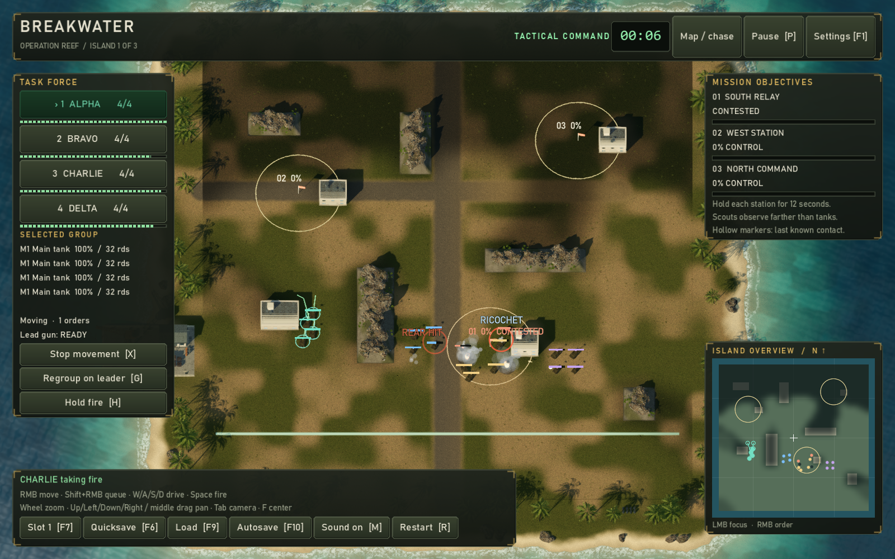

# Breakwater — Three-island campaign prototype

*A modern re-imagining of the 1992 tank strategy game Pacific Islands. Not affiliated with or endorsed by the original developers or publisher.*



A playable prototype in **Godot 4.7.2 .NET / .NET 10 / C# 14**. Procedural sound; photographed skies and textures from Poly Haven (CC0) and vehicle models from Sketchfab (CC BY 4.0), credited in [assets/CREDITS.md](assets/CREDITS.md). No original game code or assets are included. The three-mission campaign is new prototype content, not a recreation of the original game's campaign.

## Play

1. Open `project.godot` in **Godot 4.7.2 .NET** (the standard edition cannot run C#).
2. Build the C# project and press **F5**.
3. Review your groups and supplies in the briefing, then click **Deploy task force**, or press Enter.

Command four groups with up to four vehicles each. Bravo and Delta initially include two faster, lightly armored scouts. Capture all three radio stations by holding each ring for twelve seconds with no defenders nearby. Reconnaissance reveals enemies: scouts observe up to 82 meters, other vehicles 60, with buildings and ridges blocking sight. Hollow markers show a contact's last observed position for up to 30 seconds. Dark ground is unseen; dim ground was previously explored.

Buildings and ridges block movement and fire. Tanks route around them and avoid other vehicles. Use multiple groups to flank enemy armor. Damaged or depleted vehicles can return to the southern beach supply zone: stop south of the bright line, out of contact, to repair and rearm. Wrecks remain as obstacles.

## Campaign and deployment

Complete **Reef → Breakwater → Signal**, each with a different layout, cover and objectives. After victory, click **Continue to next island**. Survivors retain their health; losses remain empty slots. Ammunition is replenished during transit, and each transition grants **100 supplies**.

Before deploying, use the four group rows to manage your force:

- **Refit** cycles Armor (four main tanks), Mixed (two main tanks/two scouts), and Recon (four scouts). The button shows the next composition and its supply cost or refund. Damage is preserved.
- **Repair** restores surviving vehicles in that group, at the displayed cost. It cannot revive destroyed vehicles.
- **Replace one** fills the first lost slot in that group: 40 supplies for a main tank or 25 for a scout.

You start with 100 supplies. The final victory screen records campaign time and cumulative losses. **Retry this island** restores that island's deployment roster and supplies; it does not erase losses from previous islands. **New campaign** starts over after a second click (or immediately after campaign completion) and leaves saved checkpoints intact.

## Classic mode

Click **Play Classic rules** on the briefing screen to start a campaign under rules loosely modelled on the classic early-90s island tank game (the tuning, islands, text and art are Breakwater's own). You field M1 Abrams tanks, M2 Bradleys, M113s and ITV missile carriers against T-72s, T-62s, BMP-2s and BTR-60s. Each vehicle carries HEAT, sabot or missiles and a machine gun, picks the right round for its target, and must reload to change type. Damage is weapon power over armour, so HEAT barely dents an M1 and a missile wrecks a carrier outright.

The islands gain roads, tracks, jungle and a river. Roads are fast but exposed; jungle is slow, but its edge is the best cover on the island, spreading enemy fire sixteen times wider. Deep jungle hides a vehicle until it fires, and rivers can be forded anywhere, slowly. Routes follow the roads when that is quicker. Defenders hold their ground: destroy each garrison, then hold its station. Click **Play Modern rules** to switch back. Either button starts a new campaign.

In a Classic battle, **Tab** cycles the tactical map, the chase camera and the **gunner sight**, a first-person view along the selected leader's gun. There, the mouse or the turn keys traverse the turret, a click or **Space** fires the loaded round, right-click changes ammunition, and the wheel switches between 1× and 6×. The rangefinder reads the distance to whatever the gun is laid on. If the leader is knocked out, the sight passes to the next vehicle in the group.

Support weapons: **C** fires smoke from the selected group (it blocks sight both ways for 40 seconds), **N** makes its leader lay a mine (it arms after five seconds and hurts anyone, you included), and **B** readies one of three artillery missions per battle: press it again to change the shell (high explosive, cluster, smoke), then right-click the ground or map to fire. The enemy has guns and a hidden minefield too; its fire missions are announced with an alarm and a ring where they will land.

Classic campaigns run on money: you start with $55 million, vehicles cost their real-world prices, each enemy destroyed pays a bounty, winning an island pays $10 million, and knocking down a civilian building costs $2 million. Buildings can be destroyed in Classic battles, which opens new lines of sight and routes.

Classic campaigns are fought **zone by zone**: each island has several battles, shown on a zone map in the briefing, and ends with the battle for all its stations. Objectives include capturing stations, knocking down a radar, clearing every enemy from the jungle, ambushing a convoy on the coast road, holding the seawall against two enemy columns, and escorting a supply convoy you cannot command. The first island opens with two training battles: a drive to an undefended relay, and a gunnery range. Classic is about gunnery: your crews shoot badly on their own, and a gun you aim yourself is far more accurate. Battles open in the group windows; click a sight to take that gun, lay it with the turn keys, click to fire, and the gunner calls every shot: HIT with the damage, KILL with the bounty, or MISS. Both sides open each Classic battle holding their fire until an enemy comes within about 1.6 km or someone is hit, so you can land, look and choose when to start the fight; press **H** (weapons free) or use the gun sight to open fire first. Some battles set a condition: lose no more than four vehicles, win within ten minutes, or destroy no civilian building. Break it and the mission fails.

The second Classic island is a **night battle**: your thermal sights see as far as by day, but the enemy sees less than half as far, until your muzzle flash gives you away.

Turn on **Retro look** in the settings (F1) for chunky pixels, a small palette and dithering, and **Retro sound** for crunchy 8-bit samples on four channels, in either mode.

Press **Tab** once more for the **group windows**: four windows, one per group, each switchable between that leader's sight, the map (right-click it to order that group) and a status report. Click a window to select its group; in the selected group's sight, a click fires and the turn keys lay the gun. The ⤢ button shows a window full screen.

## Controls

These are the default keys. Open **Settings [F1]** to change keyboard bindings; in-game hints follow your choices.

| Control | Action |
| --- | --- |
| 1–4 / group panel / left-click friendly tank | Select group |
| Right-click ground or minimap | Move selected group in formation |
| Shift + right-click | Append waypoints, up to eight per vehicle |
| X | Stop selected group |
| G | Regroup surviving vehicles behind their leader |
| H | Toggle automatic fire for selected group |
| W / S | Drive the first surviving vehicle forward / backward |
| A / D | Turn that vehicle |
| Space | Request a shot from the lead vehicle (aim, range, ammo and reload still apply) |
| Tab | Tactical / chase camera; in Classic battles, also the gunner sight and the group windows |
| Mouse wheel | Tactical zoom |
| Arrow keys / middle-mouse drag | Pan tactical view |
| F | Center tactical focus on the selected group's leader |
| Left-click minimap | Focus tactical camera there |
| P / Escape | Pause / resume; movement orders remain available while paused |
| F1 / Settings button | Open settings, pausing combat until you close them |
| F7 | Cycle between three manual checkpoint slots |
| F6 / F9 | Save / load the selected checkpoint slot |
| F10 | Resume the deployment or island-transition autosave |
| M | Toggle sound |
| R | Retry current island after a defeat; during combat press twice to confirm. Ignored on the victory screen, so a won island can't be discarded by accident |

Driving controls only the lead vehicle; press G to bring its group back together. Automatic fire starts enabled. Vehicles wait for turret alignment, expend ammunition, and fire traveling shells that can hit cover, wrecks or crossing friendly vehicles. Front armor is strongest; rear armor is weakest.

Use **Save campaign / F6** in the briefing, during combat, or on an outcome screen. During active combat, wait until shells have landed. **Load checkpoint / F9** restores the island, logistics, roster, reconnaissance and mission state; active combat resumes paused. **F7** selects one of three slots, stored as Godot's `user://quicksave.json`, `quicksave-2.json` and `quicksave-3.json` (normally under `%APPDATA%/Godot/app_userdata/` on Windows).

A separate `campaign-autosave.json` records the force immediately before deployment and after each island transition. **F10** restores that briefing; it does not recover ongoing combat between those points. Manual checkpoints remain independent. Version-1 single-mission saves load as island one; version-2 campaign saves also migrate, with reconnaissance initialized from the loaded positions.

## Settings

Settings are available from both the briefing and combat HUD. Adjust master, combat and radio volume independently, mute all audio, switch fullscreen, or change camera pan speed. Click a keyboard binding, then press its replacement. Assigning an occupied key swaps the two commands. Bindings use physical US QWERTY key positions; mouse controls, Shift for queued orders, F1 for settings and Escape remain fixed. Modifier combinations and controller bindings are not supported yet.

**Apply settings** saves and activates your choices. **Cancel** discards pending edits. **Restore defaults** prepares a reset which you can apply or cancel; your selected save slot is retained. Escape cancels an active key capture first, then closes settings. Closing returns to the previous pause state. Preferences live separately from campaign saves in `user://settings.json`; audio mute and save-slot selection also persist when changed through their normal controls. Invalid settings fall back to defaults with an on-screen notice.

## What is implemented

- A* routes with hull clearance, route smoothing, queued formation orders, collision and local traffic replanning.
- Turret aiming, line of sight, projectile travel, nearest-impact collision, directional armor, ammunition and reloads.
- Main tanks, scouts, enemy defenders, beach resupply, reversible captures and mission outcome screens.
- Clickable group controls, health/ammo/reload readouts, route lines, minimap orders, camera pan/zoom and pause-to-plan.
- Fog of war, shared reconnaissance, persistent exploration and last-known contact markers on the battlefield and minimap.
- Defenders patrol, investigate contacts, flank and retreat using observed positions rather than tracking hidden units.
- Three manual save slots, separate deployment/transition autosave and versioned checkpoint migration.
- Hit indicators, damaged-vehicle smoke, positional shot/impact sounds and synthesized radio cues.
- Persistent audio/display/camera preferences, remappable keyboard controls and dynamic shortcut hints.
- Engine-independent simulation separated from scene rendering, UI and audio.
- Three authored islands, persistent damage/losses, supply accounting, deployment refits, repairs, replacements and campaign results.

## Build and verify

The Poly Haven scans under `assets/art-study/` are not in git: the campaign scenery and `ArtStudy.tscn` load them, so fetch them once after cloning (the script checks every file against its published checksum):

```powershell
./Tools/FetchArtStudyAssets.ps1
```

```powershell
dotnet build Breakwater.csproj
dotnet test --project Tests/Breakwater.Tests.csproj
./Tools/Check.ps1   # uses $env:GODOT, or pass -Godot 'C:/path/to/Godot_v4.7.2-stable_mono_win64_console.exe'
```

`Check.ps1` builds, runs the simulation tests, then executes Godot combat, UI, campaign, Classic-mode, view-state, scenery and settings checks. The view-state check exercises thermal sight transitions and callout resets across new campaigns, retries, checkpoint loads and island changes. Run with `-- --view-state-test` in a graphical window to also capture these transitions under `.godot/qa/view-state-*.png`. The scenery check verifies flat navigable ground and scanned rock bounds on every island in both modes. A second settings process verifies persistence across a restart. A check fails if Godot exits non-zero, never prints its PASS marker, or logs any error along the way (`GD.PushError`, an engine or shader error, or an unhandled C# exception, which Godot otherwise logs and survives); Godot warnings are reported but do not fail the run. These checks use separate checkpoints, autosaves and preferences under `.godot/qa`; they do not replace your campaign saves or settings.

The build treats warnings as errors and enforces the `.editorconfig` style rules (see `CLAUDE.md`). The simulation tests are xUnit v3, and run without Godot.

Verified on Godot 4.7.2 .NET after the September 2026 code-quality refactor: `Check.ps1` passes end to end (simulation tests, then the smoke, UI, campaign, settings and settings-reload checks), and the tactical and briefing screens were re-rendered and inspected. The simulation tests cover an entire campaign with save/load and persistent survivors, reconnaissance occlusion/memory, defender tactics and hidden combat-event suppression. Combat, UI and campaign checks cover slot selection and independent autosave restoration. Settings checks exercise remapped driving and commands, conflict swaps, reserved keys, Apply/Cancel/defaults, pause restoration, audio gain, updated HUD hints, invalid data and preferences loaded by a fresh process. Deployment, tactical, chase and settings screens have been rendered and inspected using OpenGL. The restricted environment has emitted NuGet vulnerability-feed and Windows certificate-store warnings; build and gameplay checks succeeded. Audio playback quality and broader campaign balance still need human playtesting.

For individual Godot checks, replace `godot` with your executable:

```text
godot --headless --path . --fixed-fps 60 --quit-after 1800 -- --smoke-test
godot --headless --path . --fixed-fps 60 --quit-after 1800 -- --ui-test
godot --headless --path . --fixed-fps 60 --quit-after 1800 -- --campaign-test
godot --headless --path . --fixed-fps 60 --quit-after 1800 -- --classic-test
godot --headless --path . --fixed-fps 60 --quit-after 1800 -- --settings-test
godot --headless --path . --fixed-fps 60 --quit-after 1800 -- --settings-reload-test
```

Run the settings checks in the order shown: the first writes the fixture used by the reload check. Visual QA options: `-- --preview --screenshot=C:/absolute/path.png` starts a tactical preview and captures the viewport. Use `--battle-preview` to stage a close-range skirmish (fire opens at physics frame 60, so capture around frame 90 to catch explosions; combine with `--chase-preview` for a ground-level view), `--capture-preview` to show the objectives mid-capture (contested, half held, and just secured), `--counter-attack-preview` to show an enemy counter-attack and reinforcement landing (capture around frame 120), `--chase-preview` for the chase view or `--settings-preview` for the settings panel; omit them all for the briefing. `--classic` previews under Classic rules, and `--classic --battle-preview --sight-preview` looks through the gunner sight at the staged skirmish; `--windows-preview` in place of `--sight-preview` shows the group windows in each mode, `--retro` forces the retro look on, `--classic --island=1` previews the night island (add `--battle=0` for its first battle), and `--classic --support-preview` stages smoke, a mine and fire missions from both sides. `--lineup-preview` lines up every vehicle model with its turret turned (add `--focus=T72`, or any vehicle kind, for a close-up), `--island=1` previews Breakwater and `--island=2` previews Signal with fresh forces. `--screenshot-frame=120` delays capture. These options exit after capture and require a graphical renderer.

## Project layout

| File | Responsibility |
| --- | --- |
| `Scripts/Core/Mission.cs` | Force structure and island layouts |
| `Scripts/Core/Vehicle.cs`, `VehicleSpec.cs`, `CaptureSite.cs`, `Shell.cs`, ... | Simulation model, one type per file, with its gameplay constants |
| `Scripts/Core/Campaign.cs` | Persistent roster, logistics and island progression |
| `Scripts/Core/Geometry.cs`, `Navigation.cs` | Swept collision queries and A* pathfinding |
| `Scripts/Core/Simulation.cs` | Orders, movement, capture and resupply |
| `Scripts/Core/Simulation.Combat.cs` | Targeting, firing, shells and armour |
| `Scripts/Core/Simulation.Ai.cs` | Defender tactics |
| `Scripts/Core/Simulation.Classic.cs`, `ClassicRules.cs`, `WeaponSpec.cs`, `TerrainMap.cs` | Classic mode: ammunition, damage, scatter, terrain and holding defenders |
| `Scripts/Core/Reconnaissance.cs` | Team observation, exploration and remembered contacts |
| `Scripts/Core/SaveGame.cs` | Versioned save DTOs and validation |
| `Scripts/Battle.cs`, `Battle.Settings.cs` | Scene root: input, commands, campaign flow, preferences |
| `Scripts/CameraRig.cs` | Tactical and chase cameras |
| `Scripts/CampaignStorage.cs` | Save, autosave and settings paths; atomic writes |
| `Scripts/BattleView.cs` | Procedural environment, vehicles and effects |
| `Scripts/BattleView.Terrain.cs`, `Silhouette.cs` | Classic ground and jungle; vehicle shapes by kind |
| `Scripts/VehicleAssets.cs`, `ModelSpec.cs` | The downloaded vehicle models: fitted to the game and cut into hull and turret |
| `Scripts/VehicleModel.cs`, `MeshBuilder.cs` | Procedural vehicles, used if a model is missing |
| `Scripts/SurfaceTextures.cs`, `Credits.cs`, `assets/` | Photographed skies and surface textures, vehicle models, and their credits (`assets/CREDITS.md`) |
| `Scripts/BattleView.Scenery.cs`, `Flora.cs`, `Shaders/` | Palms, trees, buildings and rocky ridges, and the shaders that dress them |
| `Scripts/Core/Simulation.Gunner.cs`, `Scripts/GunSight.cs` | Classic gunner sight: manual laying, firing and rangefinder; the optic overlay |
| `Scripts/GroupWindow.cs`, `CameraView.cs`, `WindowMode.cs` | Classic group windows: a sight, map or status per group |
| `Scripts/Core/Simulation.Support.cs`, `Scripts/BattleView.Support.cs` | Classic smoke, artillery and mines, and how they are drawn |
| `Scripts/Core/ClassicCampaign.cs`, `ZoneBattle.cs`, `Scripts/ZoneMap.cs` | Classic zone campaign: the battles of each island, and the briefing's zone map |
| `Scripts/CommandHud.cs`, `CommandHud.Modal.cs` | Command UI and the briefing/outcome screen |
| `Scripts/TacticalMap.cs`, `WorldOverlay.cs` | Minimap; health bars and labels over the battlefield |
| `Scripts/Palette.cs` | Every colour, in one place |
| `Scripts/InstrumentStyle.cs`, `UiFonts.cs` | The HUD's instrument-panel plates and gauges, and its system typefaces |
| `Scripts/GridImage.cs` | Smooth fog and ground textures painted from the cell grids |
| `Scripts/BattleAudio.cs` | Procedural sound cues |
| `Scripts/GameSettings.cs`, `CommandIds.cs` | Validated preferences and key bindings |
| `Scripts/SettingsPanel.cs` | Settings UI, draft edits and keyboard capture |
| `Scripts/QaDriver.cs`, `QaDriver.Settings.cs` | Opt-in Godot runtime checks and previews |
| `Tests/` | xUnit v3 simulation tests |

See [design notes](Docs/DESIGN.md) for mechanics, implementation decisions and limitations.

Still to come: traversable elevation, finished art/audio, controller support, broader accessibility options and human playtesting. Crowded routes may benefit from intermediate waypoints. Vehicle statistics are provisional game values, not historical specifications.

Breakwater was inspired by Pacific Islands (1992). This project is not affiliated with or endorsed by the original developers or publisher, and uses none of their code, art, sound or campaign content.

## Licence

The code and documentation are released under the [MIT License](LICENSE). Third-party assets keep their own licences: the vehicle models are CC BY 4.0 and need their authors credited, and the Poly Haven skies, textures and scans are CC0. See [assets/CREDITS.md](assets/CREDITS.md).
